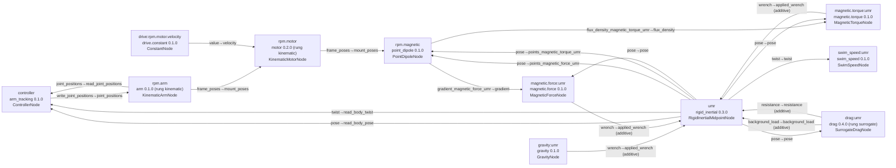

# Showing an experiment: its tree and its graph

Two views of an experiment, neither of which runs it:

- **the tree**, what the experiment declares: its structures, media and bodies, its apparatus, each law with the things it
  binds, its observations, and its controller, each with the id and version of the registered entry behind it;
- **the graph**, what it compiles to: the MADDENING graph, every node, edge and coupling group of it, as Mermaid text.

Both come from Python and from the command line, and both are the same for the same experiment whatever the order its script
declared things in. Tutorial A0 ([the tutorial](tutorial_a0.md)) is the experiment shown here.

## The tree

`experiment.tree()` is the declaration as a tree. It builds nothing and checks nothing, so it shows an experiment the build
would refuse as well as one it accepts; `str(tree)` is plain indented text, and `tree.record()` is the same structure as data
(the `mime.tree` format). From a saved folder:

<!-- mime-fragment: a command line; its output is the next block -->
```sh
mime show my_experiment --tree
```

`--tree` is the default, so `mime show my_experiment` is the same command. On a terminal the tree is drawn with guide lines
(bold on the headings, which sets them apart and says nothing the words do not); piped, or with `--plain`, `NO_COLOR` or
`TERM=dumb`, it is plain text, the same bytes every time. `--json` prints the data. Tutorial A0's tree:

<!-- mime-fragment: tutorial A0's tree as it is printed; tests/docs/test_graph_and_tree_page.py holds this block to the experiment's own tree, so one changed character fails it -->
```text
experiment tutorial_a0  (profile exploratory)
  structures
    tube  tube 0.1.0
      regions lumen, wall
      surfaces inner_surface
      directions axis
  media
    water  fills tube.lumen
      still, no flow dynamics
  bodies
    umr  rigid_inertial 0.3.0
      part shell  screw 0.3.0
  apparatus
    rpm
      chain arm  arm 0.1.0, rung kinematic
      chain motor  motor 0.2.0, rung kinematic
      part rotor_magnet  cylinder 0.1.0  (mounted on motor.rotor; permanent magnet)
      field magnetic  point_dipole 0.1.0
      drive motor.velocity  drive.constant 0.1.0
  laws
    contact:umr  contact 0.1.0, rung projection
      between body umr, surface tube.inner_surface
    drag:umr  drag 0.4.0, rung surrogate
      between body umr, medium water
    gravity:umr  gravity 0.1.0
      between body umr, medium water
    magnetic.force:umr  magnetic.force 0.1.0
      between body umr, field rpm.magnetic
    magnetic.torque:umr  magnetic.torque 0.1.0
      between body umr, field rpm.magnetic
  observations
    swim_speed:umr  swim_speed 0.1.0
      reads body umr
      gives distance, mean_speed, observed, speed
  controller
    arm_tracking 0.1.0  (mode graph)
      reads body_pose <- umr.pose, body_twist <- umr.twist, joint_positions <- rpm.arm.joint_positions
      writes joint_positions -> rpm.arm.joint_positions
```

Each line is the name the experiment declares and, after it, the registered entry (its id and version, and its rung where it has
one): `umr  rigid_inertial` is the body `umr`, whose motion is the `rigid_inertial` dynamics. A law's second line says what it is
between, in the order its roles are declared (`body`, then `medium`, `field` or `surface`); a controller's says what each label
it reads comes from and what each label it writes goes to. The tree lists what the experiment declares, not what the build
derived: a law bound to a name nothing declares is listed with the name it was given.

The tree is the topology: what is made of what, and what each law and observation binds. It does not list the declared values
(a mass, a viscosity, a magnetic moment, each with its reason), the settings of an entry other than its rung, the run's settings
(`dt`, the duration, the seed), the scene's references or the initial state; a value missing from the tree is not undeclared.
`mime show` reads the saved document, which holds them.

## The graph

`built.to_mermaid()` is the graph the build made, as a Mermaid flowchart. It is MADDENING's own `to_mermaid`, so every node,
edge, coupling group and external input of the graph is in it and nothing is drawn a second time; MIME adds, under each node's
name, the registered entry that built it, because the name of a node's class (`SurrogateDragNode`) is internal. From a saved
folder:

<!-- mime-fragment: a command line; its output is the next block -->
```sh
mime show my_experiment --graph
```

`--tree --graph` prints both, the tree first. The graph builds the experiment, which the tree does not. Not every law of the tree
is a node of the graph: `contact:umr` is a projection applied to the body's state outside the graph, so it is in the tree and
has no node or edge in the graph (the [build report](build_report.md) lists it as a rule). Tutorial A0's graph:

<!-- mime-fragment: tutorial A0's graph as it is printed; tests/docs/test_graph_and_tree_page.py holds this block to the experiment's own graph, so one changed character fails it -->


An edge reads `field→input`, with `(additive)` where the edge adds into its target's input (loads, wrenches) and no mark where
it replaces it. The graph shows the edges and not the step each reads, which [the build report](build_report.md) lists as the
lag of every edge. `direction=` is MADDENING's (`LR`, `RL`, `TB` or `BT`): `TB` stacks a wide graph.

## In a notebook

`built.to_mermaid()` returns a `str` that also tells a notebook how to show it: a `text/markdown` Mermaid fence, which a front end
that draws Mermaid in Markdown draws as a diagram, and which any other shows as the Mermaid text, with a line under it saying
where to draw it (mermaid.live); under a diagram that is drawn, the line reads as a pointer to where it can be edited. Nothing
is loaded from a network to draw it. `print(built.to_mermaid())` is the plain text.

What the front ends do with that fence was measured on 2026-11-05, by opening a notebook that held the output in a Chrome 148
driven by a script, and looking for a drawn diagram in the page (and for any request leaving the machine: there was none):

| Front end | Draws the Mermaid fence |
|---|---|
| JupyterLab 4.1.8, 4.2.7 and 4.6.5 | yes, as a diagram |
| Jupyter Notebook 7.6.4 | yes, as a diagram |
| JupyterLab 4.0.13 | no: the Mermaid text, in a code block, with the line pointing to a renderer |
| VS Code's notebooks | not measured: the measurement needs the editor, which was not available |
| Google Colab | not measured: it needs a Google sign-in, which the measurement could not use |

A cell shows whether a front end draws it, in one line:

<!-- mime-fragment: a cell for a notebook, not a script; it shows the fence the page describes -->
```python
from IPython.display import display
display({"text/markdown": "```mermaid\nflowchart LR\n    a --> b\n```"}, raw=True)
```

If it shows two boxes and an arrow, the front end draws Mermaid; if it shows the text, it does not, and the one line under the
output of `to_mermaid()` says where to paste it.

## What these views do not say

The tree and the graph say what the experiment is made of and how it is wired, which is the structure; they say nothing of whether
the physics is right, and the graph says nothing of what a run will do. They are held to the experiment they were made from (the
tests read the Mermaid back and compare it with MADDENING's description of the graph, and the tree with phase 1's resolution of
the same declarations), not to a drawing a person checked.
